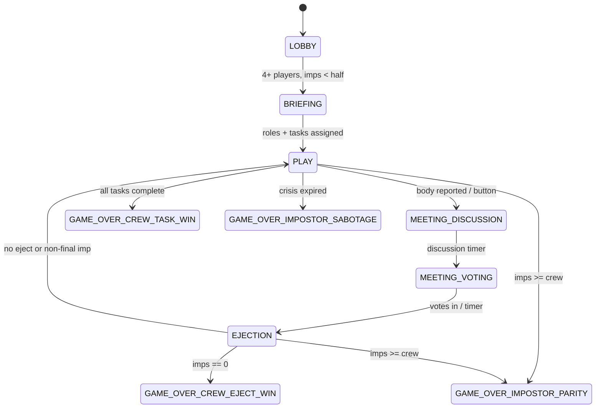

# 02 — Among Us Core

**Project Among Vessels** · Phase 2 research deliverable · Status: **analysis complete**
Canonical data: [`tools/data/state_machine.json`](tools/data/state_machine.json), [`tools/data/balance_defaults.json`](tools/data/balance_defaults.json)
Feeds: [03_HYBRID_MECHANICS.md](03_HYBRID_MECHANICS.md) · [04_AI_ARCHITECTURE.md](04_AI_ARCHITECTURE.md) · [05_QUICKCHAT_GRAMMAR.md](05_QUICKCHAT_GRAMMAR.md)

> Deconstruction of the loop we are keeping. Nothing in this document may be replaced by a SIGNALIS or
> Zomboid idea; those adapt *around* this spine (see [03](03_HYBRID_MECHANICS.md) §1). Where our
> numbers differ from the reference game, the difference is deliberate and stated.

---

## 1. The Loop in One Page

Among Us is a **hidden-role, imperfect-information, real-time-then-turn-based game** with a hard
alternation between two modes:

```
        ┌──────────────────── PLAY (real-time, ~60–120s per segment) ────────────────────┐
        │                                                                              │
        ▼                                                                              │
  Crewmate: walk ▸ do tasks ▸ watch ▸ avoid isolation ▸ find body                    │
  Impostor: walk ▸ fake tasks ▸ isolate ▸ KILL ▸ vent/escape ▸ sabotage for cover      │
        │                                                                              │
        └──────────────┬───────────────────────────────┬───────────────────────────────┘
                       │ body reported                  │ emergency button
                       ▼                                ▼
        ┌──────────────── MEETING (discussion ▸ voting) ────────────────┐
        │ claims ▸ accusations ▸ alibis ▸ deduction ▸ plurality vote     │
        └──────────────┬────────────────────────────────────────────────┘
                       ▼
                 EJECTION (or skip) ──► back to PLAY, or GAME OVER
```

**The loop is a *tension pump*.** Play generates private information (who was where, who is missing,
who is faking). Meetings convert private information into public claims, which are *costly* to make
and *unverifiable* in the moment. Everything interesting in the game happens in that conversion.

### The five-beat cycle (our canonical loop)

| Beat | Duration | Purpose | Failure if absent |
|---|---|---|---|
| **1. Disperse** | 5–10s | Players leave the meeting point, breaking clumps | Everyone travels as a blob; no alibis, no isolation |
| **2. Commit** | 40–90s | Tasks pull crew apart spatially; impostor picks a victim | No separation of information |
| **3. Incident** | 2–10s | Kill, sabotage, vent, or witnessed oddity | No new information enters the game |
| **4. Discover** | 5–30s | Body found / crisis noticed / player returns changed | Information dies with the victim |
| **5. Convene** | 30–120s | Discussion + vote converts information to a decision | The game becomes pure hide-and-seek |

**Design consequence for our game:** every system must name which beat it serves. A survival system
that operates outside all five beats is bloat (see [03](03_HYBRID_MECHANICS.md) §8, "budget caps").

---

## 2. Map Flow

Among Us maps are **loops with chokepoints**, not trees. The Skeld is the cleanest example: a rough
ring (Cafeteria → Weapons → Navigation → Shields → Storage → Cafeteria) with a spine (Reactor,
Security, Electrical, MedBay, Admin) threaded through the middle.

```
                    ┌─────────── CAFETERIA (spawn, button) ───────────┐
                    │                    │                             │
              WEAPONS               (corridor)                     ADMIN
                    │                    │                             │
              NAVIGATION ──── corridor ──┼── corridor ── SECURITY      │
                    │                    │                             │
              SHIELDS ─── corridor ── STORAGE ── corridor ── ELECTRICAL
                                         │
                              UPPER ENGINE / LOWER ENGINE / REACTOR / O2 / MEDBAY
```

**Properties that matter mechanically:**

1. **Ring topology** = long travel times between distant points, so a kill on one side of the ship is
   *not* observable from the other. This is what makes "where were you?" a real question.
2. **Chokepoints** (single corridors into Electrical, Reactor, MedBay) create natural ambush sites and
   natural alibi sites. A room with one door is a room where "who went in" is knowable.
3. **Vents form a second graph** overlaid on the walk graph. Vent adjacency is a *power asymmetry*:
   it lets the impostor travel in a topology the crew cannot observe.
4. **The button is central** (Cafeteria). Reaching it is a commitment with travel cost.

**Our adoption:** one map at launch, ~14 named rooms, ring+spine topology, 5 vent clusters, 5 task
stations per room average. Map is authored as a **graph**, validated by `map_lint.py` (planned, see
[01](01_DEV_TOOLS.md) §7) before any art exists.

**Room taxonomy for AI (feeds [04](04_AI_ARCHITECTURE.md) §4):**

| Type | Example | AI meaning |
|---|---|---|
| Junction | Cafeteria, Storage | High traffic; low kill value; high witness value |
| Dead-end | Electrical, Reactor | Single entry; perfect ambush; perfect trap |
| Corridor | the four linking halls | Transit only; no tasks; highest exposure |
| Service | Admin, Security, Comms | Information stations; sabotage targets |
| Threshold | MedBay scanner, O2 keypads | Multi-actor requirements; forced cooperation |

---

## 3. Phase Machine

Canonical: `tools/data/state_machine.json` (validated by `validate_state.py`).



**Critical ordering rule.** Within `PLAY`, the evaluation order each tick is:
`parity check → sabotage countdown → task completion → body/button detection`.
Rationale: a kill that reaches parity *ends the game immediately*, even if the crew is one task from
winning. Task-win does **not** pre-empt a kill that has already resolved. This single ordering
decision is responsible for most "we were one task away!" moments — and it is the correct feel.

**Meeting suppression rules (faithful to the reference):**
- Emergency meetings are **blocked during an active crisis sabotage** (except Comms-class, which only
  blinds information). This makes sabotage a *temporal weapon*: it buys the impostor a kill window.
- Each living player has a limited number of emergency calls (default **1**).
- A meeting **cancels** an in-progress sabotage countdown (the crew's attention resets), but the
  sabotage remains *unfixed* until physically repaired.
- Bodies are cleared on meeting start; a new round begins with no bodies.

---

## 4. Task System and Pacing Budget

### 4.1 Task taxonomy

| Class | Count per crewmate (default) | Structure | Duration | Purpose |
|---|---|---|---|---|
| **Common** | 2 | Single step, everyone has it | 4–8s | Creates shared rhythm; a common task seen undone is evidence |
| **Short** | 2 | Single step, variety | 5–12s | Density of small commitments; easy to fake |
| **Long** | 2 | 2–5 stages, often multi-room | 20–60s | Forces *sustained absence*; the impostor's best cover story |

**Total per crewmate: 6 tasks.** With 8 crewmates that is **48 task-completions** to win by tasks.

### 4.2 Pacing budget (the math that keeps the game honest)

Let:
- `C` = living + dead crewmates that still contribute (ghosts work)
- `T` = tasks per crewmate = 6
- `d` = mean seconds per task = 9s (common 6s, short 9s, long 30s amortised over stages)
- `w` = walking overhead per task = 12s (mean inter-station distance ÷ speed)
- `D` = detour overhead (meetings, sabotage response, hiding) = 0.25

Task-win requires:

```
T_win ≈ C · T · (d + w) · (1 + D)
```

For C = 8: `8 · 6 · 21 · 1.25 ≈ 1260s ≈ 21 minutes` of pure task work if uninterrupted.

Meanwhile the impostor's kill budget:
```
K_max ≈ T_total / kill_cooldown      (27.5s default)
```
Over 21 minutes that is ~45 potential kills — absurdly more than needed. **This is the central
balance insight:** kill cooldown is not balanced against total task time, it is balanced against
*meeting intervals*. A match resolves in 4–8 meetings; each meeting costs one ejection and reveals one
death. Therefore:

> **Kill cooldown must be tuned so that approximately one kill occurs per meeting interval**, i.e.
> `meeting_interval ≈ kill_cooldown`. Our default interval is ~55–70s of play between meetings, and
> the kill cooldown is 27.5s — deliberately *faster* than the interval, because most of the impostor's
> cooldown is spent repositioning, not killing.

The sim confirms the emergent result: **5.3 kills and 1.4 ejections per match** (see
[01](01_DEV_TOOLS.md) §3) — a death every ~40s of play, a meeting every ~2.5 deaths.

### 4.3 Task design rules (non-negotiable)

1. **Every task must be interruptible.** No task may lock the player into an unbreakable animation
   longer than 3s. Otherwise kills become unavoidable, and the player's skill stops mattering.
2. **Long tasks must have a visible-to-others component** (a held pose, a screen glow, a sound cue).
   This is the *observation channel*: a crewmate "doing a long task" is verifiable, which is exactly
   what makes a *fake* long task dangerous and interesting.
3. **Faking must be possible but imperfect.** The impostor can stand in the right place and mimic the
   pose. The tell is *duration, sequence, and repetition* — not a UI flag. (This is why the NPC
   suspicion model in [04](04_AI_ARCHITECTURE.md) §6 scores behaviour, not knowledge.)
4. **No task is mandatory for survival.** Tasks never gate movement, oxygen, or health. They are the
   crew's *clock*, not their *prison*.

---

## 5. Vision Cones

### 5.1 Model

Vision is the primary information channel and thus the primary balance lever.

```
visible(observer, target) ⟺
      distance(observer, target) ≤ R_observer
  ∧   |angle(target − observer) − facing_observer| ≤ θ/2
  ∧   line_of_sight(observer, target) is unobstructed
```

| Parameter | Crewmate | Impostor |
|---|---|---|
| Radius `R` | 0.75× base | 1.5× base |
| Cone half-angle `θ/2` | 60° | 75° |
| Peripheral circle | 0.25 × R, 360° | 0.35 × R, 360° |
| During **Lights** sabotage | 0.35× R, θ → 40° | unchanged |

**Why the asymmetry.** The impostor's vision advantage is not a combat advantage — it is an
*information* advantage. The impostor sees the crew before being seen, which is what makes a kill
without a witness *possible* rather than lucky. It also creates the game's greatest liar's dilemma:
an impostor who mentions something only visible with impostor vision has confessed.

**The peripheral circle matters more than the cone.** Without it, walking directly behind someone is
a free kill on every target, and matches become coin flips. Our peripheral radius is small (0.25–0.35 R)
so that "staying behind and to the side" is a *skill*, and "walking right over someone" is a mistake.

### 5.2 Information stations (second-order vision)

Vision cones are *personal* information. Stations are *shared* information with a cost:

| Station | Reveals | Cost to use | Counterplay |
|---|---|---|---|
| **Cams** (Security) | Room occupancy, 4 feeds | Standing still, visible on cam | Sabotage Comms; kill the camper |
| **Vitals** (MedBay) | Alive/dead status of everyone | Standing still | Sabotage Comms; kill the camper |
| **Admin table** | Headcount per room (no names) | Standing still | Sabotage Comms |
| **Doorlog** (optional) | Room-entry log | Standing still | Sabotage Comms |

**Design rule:** information stations must always be *stations* — a place you must physically occupy
and be vulnerable in. Never a HUD upgrade. The moment information is free, the social layer collapses
because nobody has to ask anyone anything.

---

## 6. Sabotage System

Sabotages are the impostor's **temporal** weapon: they do not kill, they *buy time*, *separate*
players, and *manufacture alibis*.

### 6.1 Categories

| Sabotage | Class | Countdown | Fix requirement | Effect |
|---|---|---|---|---|
| **Reactor** | Crisis | 45s | 2 players at 2 separate hand-scanners | Instant loss if expired |
| **O2** | Crisis | 45s | 2 players at 2 separate keypads | Instant loss if expired |
| **Lights** | Debuff | none | 1 player, switch panel | Crew vision → 0.35×; no loss timer |
| **Comms** | Debuff | none | 1 player, 2 dials | Task list hidden; cams/vitals/admin/doorlog dead |
| **Doors** | Tactical | 10s auto-open | none | Locks a room's doors; traps or denies |

**The two-player fix is the most important mechanic in the sabotage system.** A crisis that requires
two simultaneous actors creates a *forced cooperation event*: two players must travel together, arrive
together, and stand still together. That is (a) a natural alibi generator for whoever *does* respond,
(b) a natural murder site for an impostor who arrives early, and (c) a natural accusation source when
only one player shows up.

### 6.2 Cooldown rules (exact, including the subtle ones)

```
on_sabotage(type):
    if type == DOORS:  require door_cooldown_elapsed   # separate cooldown
    else:              require sabotage_cooldown_elapsed and no_active_sabotage
    start_sabotage(type)
    sabotage_cooldown does NOT tick until the sabotage is resolved   # ← key rule
```

| Rule | Consequence |
|---|---|
| Non-door sabotages share **one** cooldown | The impostor must choose *which* crisis to spend it on |
| Door locks have a **separate** cooldown | Doors are a cheap tactical tool, not a crisis |
| Sabotage cooldown **only starts when the sabotage is fixed** | Long-standing Lights sabotage starves the impostor of their next crisis — a real cost |
| **No emergency meetings during a crisis** | Sabotage is the only reliable way to deny a meeting |
| **No door sabotage during a major crisis** (and vice versa) | Prevents "lock the doors, let the reactor blow" unwinnable states |

**Our defaults:** sabotage cooldown 20s, door lock 10s, crisis countdown 45s. The crisis countdown is
tuned to `travel_time(farthest_room → fix_room) + 2 × interaction_time + 8s margin` so a *competent*
crew always has time, but only just. Countdowns must be computed from map geometry at authoring time,
not hand-waved.

### 6.3 Sabotage as narrative

Every sabotage generates a **claimable fact**: "I was fixing lights", "I was in Reactor with Blue".
This is why sabotage is the connective tissue between the mechanical loop and the Quick-Chat grammar
([05](05_QUICKCHAT_GRAMMAR.md) — `SABOTAGE_WITNESS`, `ALIBI`). A sabotage that produces no socially
usable fact is a bad sabotage.

---

## 7. Meetings, Voting, and Information

### 7.1 Meeting anatomy

| Phase | Default | Player action | NPC action |
|---|---|---|---|
| **Discussion** | 30s | State claims; hear others | Emit ≤3 Quick-Chat utterances; update suspicion |
| **Voting** | 90s | Pick a player or skip | Vote by confidence threshold; may abstain |
| **Ejection** | 5s | Watch | Comment (dead chat) |

Total meeting cost: **~125s**, i.e. a fifth of a typical match. This is why emergency meetings are
limited — a player who can call one at will can convert a losing position into a stalling engine.

### 7.2 Voting math (exact)

```
tally = count(votes by target)          # includes SKIP as a pseudo-target
if tally is empty:                      eject = none
elif max(tally.values()) is shared by ≥2 targets:  eject = none      # TIE = NO EJECTION
elif argmax == SKIP:                    eject = none
else:                                   eject = argmax
```

Three consequences that shape all downstream design:

1. **Ties are not resolved by coin flip.** They are resolved by *nothing happening*. This makes
   coordinated voting a real skill and a real weapon: two impostors splitting the crew's vote is a
   legitimate win condition in miniature.
2. **Skip is a real vote.** Abstention can *cause* a no-ejection even when a plurality exists for
   someone. Therefore NPC abstention must be modelled (it is: `vote_confidence` in the sim).
3. **Vote count is public, identity may not be** (anonymous votes option). Anonymity changes the
   *information value* of the vote itself — an anonymous 5–2 gives no social read.

### 7.3 What the vote is really doing

The vote is not "did you guess right". It is a **commitment device under uncertainty**. The three
things it measures:

| Signal | Where it comes from | Exploitable by |
|---|---|---|
| **Presence** ("where were you?") | Alibis, task claims | Impostor lies; crew cross-checks |
| **Plausibility** ("does the story fit?") | Consistency across meetings | Anyone who remembers the last meeting |
| **Trust** ("do I believe *you*?") | Accumulated credibility | Impostor who has been useful/quiet |

Our suspension model in [04](04_AI_ARCHITECTURE.md) §6 is built to keep all three separable, because
a bot that collapses them into one number becomes trivially manipulable and trivially boring.

---

## 8. Win Conditions

| Winner | Condition | Checked | Our terminal state |
|---|---|---|---|
| **Crew (tasks)** | All crewmate tasks complete (dead crew included) | Every tick in `PLAY` | `GAME_OVER_CREW_TASK_WIN` |
| **Crew (eject)** | All impostors dead | `PLAY` and `EJECTION` | `GAME_OVER_CREW_EJECT_WIN` |
| **Impostor (parity)** | `alive_impostors ≥ alive_crewmates` | `PLAY` and `EJECTION` | `GAME_OVER_IMPOSTOR_PARITY` |
| **Impostor (sabotage)** | Crisis countdown expires | `PLAY` only | `GAME_OVER_IMPOSTOR_SABOTAGE` |

**Notes and edge cases.**
- Parity is `≥`, not `>`. At 2 crew vs 2 impostors the impostors win, because the crew can no longer
  outvote them. This is why our validator requires a starting crew margin of at least 2.
- Ghosts keep working tasks (crew) and keep sabotaging (impostor) but **cannot kill and cannot speak**.
  Ghost sabotage is why "we killed the last impostor" must be checked *before* the ghost acts.
- Win conditions are not simultaneous by construction; the transition table makes ordering explicit
  and `validate_state.py` rejects any guard that could reach two different terminals from one phase.

### 8.1 Launch defaults (canonical: `balance_defaults.json`)

| Setting | Our value | Reference default | Why we differ |
|---|---|---|---|
| Players | 10 | 10 | — |
| Impostors | 2 | 2 | 1 is solvable, 3 trivializes parity |
| Common / Long / Short | 2 / 2 / 2 | 1 / 1 / 3 | More multi-room tasks = more *sustained absence* for alibi play |
| Kill cooldown | 27.5s | 45s | Faster kills keep the info pump running in single-player |
| Kill distance | short | medium | Short forces proximity = more witness events |
| Sabotage cooldown | 20s | 30s | Sabotage is the NPC director's main pacing tool |
| Crisis countdown | 45s | 30–60s | Computed from map geometry; see §6.2 |
| Discussion / Voting | 30s / 90s | 15s / 120s | NPCs need discussion runway; humans need less voting |
| Emergency meetings | 1 each | 1 | — |
| Crew / Impostor vision | 0.75× / 1.5× | 1× / 1.5× | Claustrophobia (SIGNALIS) + witness scarcity |
| Visual tasks | **off** | on | Visual tasks are an instant alibi; they short-circuit the grammar |
| Confirm ejects | **off** | on | Knowing roles removes the game's core uncertainty |
| Task bar | meetings only | always | Continuous task bar is a free information leak |

**Regression band.** Default tuning must produce a crew win rate in **[0.30, 0.60]** over ≥300 seeded
runs, and eject accuracy **< 0.95**. Enforced by `sim_headless.py guard` and the unit tests in
[01](01_DEV_TOOLS.md) §5. Current measured: crew 0.42, accuracy 0.81.

---

## 9. What We Deliberately Do Not Take From Among Us

| Reference feature | Why it is cut or changed |
|---|---|
| Free-form chat | Replaced by the closed grammar ([05](05_QUICKCHAT_GRAMMAR.md)) — required for deterministic NPC reasoning |
| Role sprawl (Engineer, Scientist, Guardian Angel, Shapeshifter, Phantom…) | Multiplies state and dilutes the core read. v1 ships **Crewmate + Impostor only** |
| Visual tasks | Provide free verified alibis; they collapse the deduction space |
| Confirmed ejects | Removes the "was that a mistake?" dread that drives the next meeting |
| Multiple maps at launch | One well-tuned graph beats five shallow ones |
| Ghost free-cam as a reward | Ghosts keep task work but get no information advantage over the living |

---

## 10. Deconstruction summary — the ten load-bearing rules

1. Play generates private facts; meetings convert them into costly public claims.
2. Every system must serve one of the five beats, or it is cut.
3. The map is a ring with a spine; chokepoints make "who went in?" answerable.
4. One kill per meeting interval is the tuning target, not one kill per cooldown.
5. Tasks must be interruptible, observable, and non-mandatory.
6. Vision asymmetry is an *information* advantage, not a combat one.
7. Information stations are places you must stand still in, never HUD upgrades.
8. Sabotage buys time; the two-player crisis fix is what creates alibis and accusations.
9. Ties and skips eject nobody — abstention is a weapon.
10. Parity is `≥`. Task-win never pre-empts a kill that already landed.

---

## Appendix A — Sources consulted

Primary and secondary references used for the deconstruction above. Reference vocabulary only; see
[00](00_SWOT_AND_STRATEGY.md) §Naming.

- Orkin, J. *Three States and a Plan: The A.I. of F.E.A.R.* (GDC 2006) — planning architecture context
  for how goals/actions separate from execution: <https://www.gamedevs.org/uploads/three-states-plan-ai-of-fear.pdf>
- F.E.A.R. AI overview (GOAP, three-state FSM, squad layer): <https://en.wikipedia.org/wiki/F.E.A.R._(video_game)>
- Among Us gameplay loop, tasks, sabotages, ghosts, win conditions: <https://tvtropes.org/pmwiki/pmwiki.php/VideoGame/AmongUs>
- Among Us maps — tasks, visual tasks, sabotage lists per map: <https://www.pcgamesn.com/among-us/maps-layout-vents>
- The Skeld task table (common/short/long, durations, station locations): <https://www.androidcentral.com/among-us-task-guide-skeld>
- Crewmate strategy guide (forced alibi, dead accusers, visual-task clears): <https://among-us.fandom.com/wiki/Guide:Crewmate>
- Critical play analysis of the loop (play session vs. voting session): <https://mechanicsofmagic.com/2022/04/07/critical-play-among-us-10/>
- Lobby settings ranges (kill cooldown, vision, discussion/voting, emergency cooldowns) used to bound
  our defaults: <https://www.reddit.com/r/AmongUs/comments/1fv1h20/so_what_do_you_guys_think_the_perfect_lobby/>
- Reference lobby guidance on discussion-vs-voting time and vision asymmetry: <https://www.shacknews.com/article/121100/best-lobby-settings-among-us>

**Confidence note.** Loop structure, sabotage categories, and win conditions are high-confidence
(corroborated across multiple sources). Exact numeric defaults are *community consensus ranges*, not
official values — hence our defaults are stated as design choices with a rationale column in §8.1,
not as claims about the reference game.
